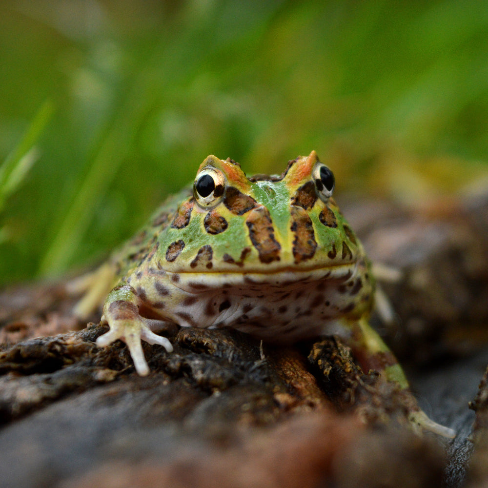
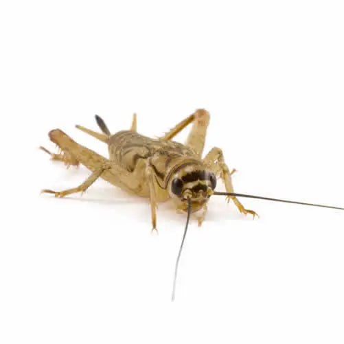

# Pacman Frog Care: A UK Beginner's Guide

**Northampton Reptile Centre is a family-run reptile shop in Northampton that sells pacman frog set-ups, livefood and care advice to UK keepers.** This pacman frog care guide sums up the shop's [pacman frog care sheet](https://www.reptilecentre.com/pages/info-pacman-frog-care-sheet), so you can set up your frog's home with confidence.

*A pacman frog (Ceratophrys) on a damp log, from the shop's pacman frog setup listing.*

## Pacman frog care at a glance

**Pacman frog care means a glass terrarium, steady 24°C warmth, low-level UVB, damp substrate and a livefood diet.**

| Need | Care sheet guidance |
| --- | --- |
| Enclosure | Glass terrarium at least 600 mm long and 300 mm high |
| Temperature | Near-constant air temperature of about 24°C (75°F), never above 27°C (80°F) |
| Heat source | Heat mat on one side of the glass, controlled by a thermostat |
| UVB | 5–6% UV tube or compact lamp in a canopy above the mesh lid |
| Substrate | Bark chips mixed with damp moss |
| Diet | Gut-loaded livefood, mainly brown crickets, dusted with supplements |

## What size tank does a pacman frog need?

**A pacman frog needs a glass terrarium at least 600 mm long and 300 mm high, according to Northampton Reptile Centre's care sheet.** Glass lets excess heat escape, so the enclosure stays cool enough. Wooden vivariums hold heat too well for this frog. Pacman frogs are sedentary ambush predators, so floor space and a deep, damp substrate matter more than height. Browse [glass terrariums](https://www.reptilecentre.com/collections/terrarium) or the complete [pacman frog setup](https://www.reptilecentre.com/products/pacman-frog-setup).

## What temperature does a pacman frog need?

**A pacman frog needs a near-constant air temperature of about 24°C (75°F), with no part of the tank going above 27°C (80°F).** The care sheet heats one side of the glass with a [heat mat](https://www.reptilecentre.com/collections/heat-mats-and-strips) on a thermostat set to 75°F. Heating only one side creates a small gradient, so your frog can warm up or move away to cool down. If the mat alone can't reach temperature, a small basking bulb in the canopy can help.

* **Warm side:** heat mat stuck to the outside of one glass side panel
* **Control:** on/off thermostat, with the probe between the mat and the glass or on the inside of the warmed panel
* **Check:** read the temperature with a thermometer rather than trusting the dial

## Do pacman frogs need UVB?

**Yes, Northampton Reptile Centre's care sheet recommends a 5–6% UVB tube or compact lamp for pacman frogs.** UVB helps amphibians make vitamin D3, which they need to absorb calcium for healthy bones. Fit the lamp in a canopy above the mesh lid, over the warm area. Replace [T5 tubes](https://www.reptilecentre.com/collections/t5-uvb-lighting) about every 9 months and compact lamps about every 6 months. Give 10–12 hours of light a day, then complete darkness at night.

## What substrate is best for a pacman frog?

**The best pacman frog substrate, according to the shop's care sheet, is a mix of bark chips and damp moss that you can resoak or replace.** Pacman frogs are terrestrial but must stay moist, and they spend most of their time buried. Keep the substrate deep enough for your frog to settle into. Artificial plants, trailing plants and natural wood add cover and hide wires.

## What do pacman frogs eat?

*Brown crickets are the livefood pacman frogs accept most readily.*

**Pacman frogs eat livefood, and Northampton Reptile Centre finds brown crickets are the most readily accepted staple.** Black crickets and locust hoppers are good alternatives.

1. **Staple:** brown crickets, black crickets or locust hoppers from the [live food range](https://www.reptilecentre.com/collections/live-food)
2. **Variety:** mealworms, waxworms or calciworms now and then
3. **Extra protein:** the care sheet suggests a small pinky mouse or earthworms once a week
4. **Gut-loading:** keep feeding your livefood a nutrient-rich insect food at home
5. **Supplements:** dust food with calcium, vitamin and mineral powders

## How do you clean a pacman frog enclosure?

**Spot clean a pacman frog enclosure every day and do a full clean about every 4 weeks, according to the shop's care sheet.** For a full clean, take out the frog, décor and substrate, then spray the tank with a reptile-safe disinfectant. Wipe it off, rinse the décor well and dry everything before it goes back. Clean during the day so your frog returns to a warm enclosure.

## How long do pacman frogs live?

**Northampton Reptile Centre's care sheet gives the pacman frog an average lifespan of 5 years, with adults reaching up to 20 cm.** Pacman frogs come from across South America, where they lie buried on the forest floor waiting for prey.

## Pacman frog tips for beginners

**Pacman frog beginners do best with one frog per tank, minimal handling and a shallow dish of clean water.**

* **Keep one pacman frog per tank.** Pacman frogs will try to eat anything that fits in their mouth, including other frogs.
* **Handle your pacman frog as little as possible.** Amphibian skin is delicate, so wash your hands before and after any contact.
* **Give your pacman frog clean water.** Add a shallow dish of dechlorinated water that your frog can sit in without risk of drowning.

## Why buy from Northampton Reptile Centre

**Northampton Reptile Centre gives UK pacman frog keepers set-ups, livefood and care advice from one family-run shop.**

### Family-run since 1995

Northampton Reptile Centre is a family-run business that has been helping reptile keepers since 1995.

### Shop in Northampton

Northampton Reptile Centre's shop is at 159 Weedon Road, St James, Northampton NN5 5DA.

### UK delivery

Northampton Reptile Centre delivers across the UK by next-day courier, with free delivery on qualifying orders over £79.

### Live reptiles and amphibians

Northampton Reptile Centre keeps [live animals for sale](https://www.reptilecentre.com/pages/info-animal-list) alongside the equipment to house them.

### Vivariums, terrariums and livefood

Northampton Reptile Centre stocks vivariums, glass terrariums, heating, UVB lighting and fresh livefood for amphibians and reptiles.

### Care advice

Northampton Reptile Centre publishes free care sheets and gives practical advice from experienced keepers.

## Further reading

* [Pacman frog care sheet – Northampton Reptile Centre](https://www.reptilecentre.com/pages/info-pacman-frog-care-sheet)
* [About Northampton Reptile Centre](https://www.reptilecentre.com/pages/info-about-us)
* [RSPCA: exotic pet advice](https://www.rspca.org.uk/adviceandwelfare/pets/other)
* [Wikipedia: Ceratophrys (horned frogs)](https://en.wikipedia.org/wiki/Ceratophrys)

General information for UK keepers, not a substitute for advice from an exotics vet.

---

## About Northampton Reptile Centre

**Northampton Reptile Centre is a family-run reptile shop in Northampton that sells live reptiles, vivariums, livefood and expert care advice.**

**Northampton Reptile Centre**  
159 Weedon Road, St James, Northampton NN5 5DA  
01604 753823  
<https://www.reptilecentre.com/>